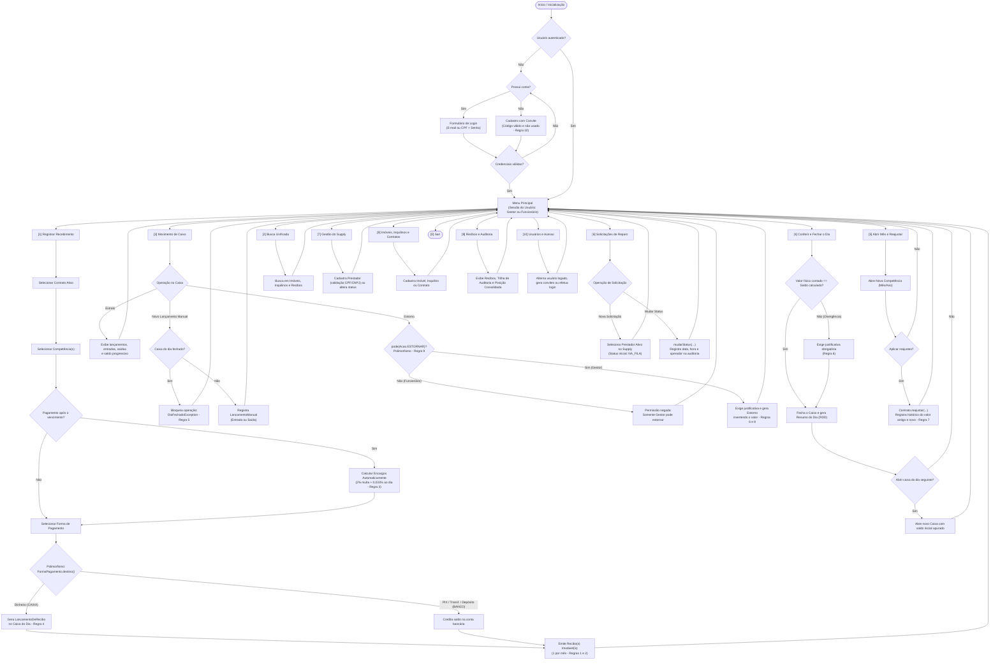

# Fluxo Operacional e de Regras de Negócio · Kosmos

Diagrama de fluxo Mermaid que ilustra a navegação geral, a validação de permissões de acesso e os fluxos operacionais da plataforma **Kosmos** (gestão de locações e caixa da Fundação Manuel Cruz), exercitando os pilares de Programação Orientada a Objetos e as regras de negócio do sistema.

